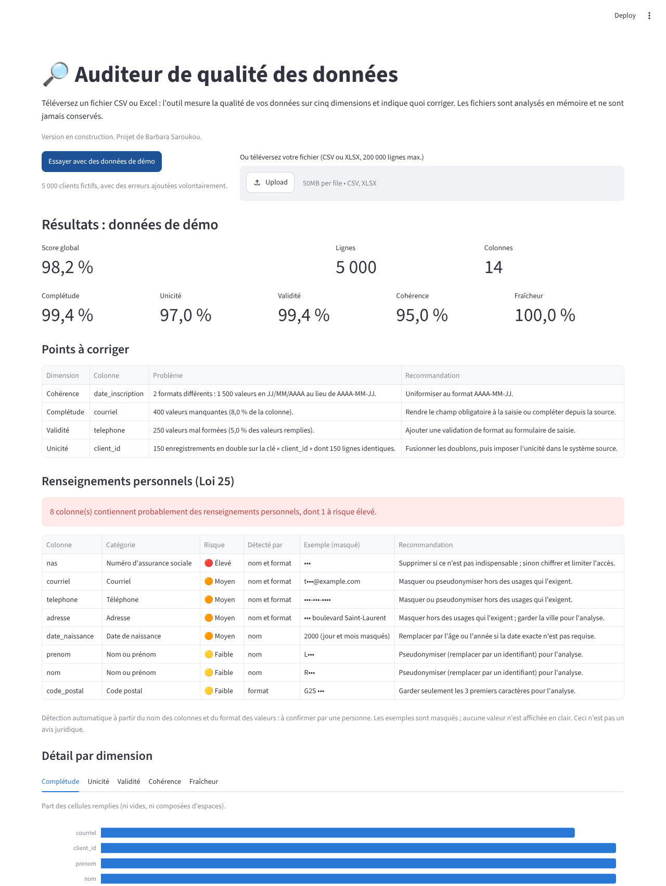

# Auditeur de qualité des données

Outil Streamlit qui note la qualité d'un jeu de données (complétude, unicité, validité,
cohérence, fraîcheur) et repère les renseignements personnels (Loi 25).
Projet de portfolio de Barbara Saroukou. **En construction : phase 4 sur 5 terminée.**

## Démarrer
```
pip install -r requirements-dev.txt
python scripts/generate_demo_data.py --rows 5000 --seed 42
pytest --cov=dq --cov-report=term-missing
streamlit run app.py
```



Voir `SPEC.md` pour les règles et `tasks/` pour l'avancement.
Toutes les données de `data/` sont fictives.
